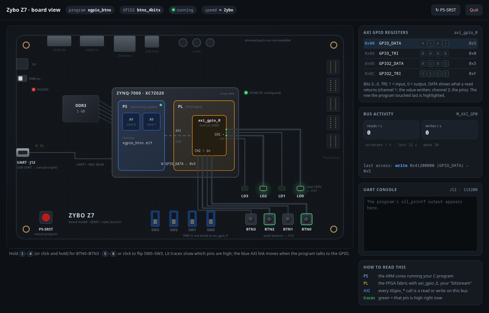

# fpga-board-sim

Work with the Digilent **Zybo Z7** (Zynq-7000) and **Basys3** (Artix-7) boards without
having the hardware on your desk, and use the same files with Vivado/Vitis when you do.
Made for USN's *SW/HW co-design of embedded systems* course.

| | Zybo Z7 | Basys3 |
|---|---|---|
| **Emulated** | ARM programs run in QEMU (`xilinx-zynq-a9`) against a model of the board; the PL designs are tested in GHDL | your VHDL runs in GHDL, clock-accurate |
| **Live board view** | LEDs, buttons, switches, AXI GPIO registers, bus activity, UART console | 16 LEDs, 16 switches, 5 buttons, 4-digit 7-segment display |
| **Real board** | scripted Vivado block design → `.xsa` → Vitis apps → JTAG | Vivado bitstream → program over USB |




Everything is driven by one command-line tool, `boardsim`, written in Python and managed
with [uv](https://docs.astral.sh/uv/). The ARM cross-compiler, CMake and Ninja are
downloaded by [Conan](https://conan.io) on the first build. Windows, macOS and Linux all
run the same commands.

## Install

You need **uv**, **QEMU** (Zybo) and **GHDL** (VHDL). GTKWave and Vivado/Vitis are optional.

| | Windows | macOS | Linux |
|---|---|---|---|
| uv | `winget install astral-sh.uv` | `brew install uv` | `curl -LsSf https://astral.sh/uv/install.sh \| sh` (or your package manager) |
| QEMU | `winget install SoftwareFreedomConservancy.QEMU` | `brew install qemu` | `sudo apt install qemu-system-arm` · `sudo pacman -S qemu-system-arm` · `sudo dnf install qemu-system-arm` |
| GHDL | zip from [GHDL releases](https://github.com/ghdl/ghdl/releases) (`bin/` on `PATH`), or MSYS2: `pacman -S mingw-w64-ucrt-x86_64-ghdl-llvm` | tarball from [GHDL releases](https://github.com/ghdl/ghdl/releases) (`bin/` on `PATH`) | `sudo apt install ghdl` · `paru -S ghdl` (AUR) |
| waveforms (optional) | [GTKWave](https://gtkwave.sourceforge.net) or [Surfer](https://surfer-project.org) | `brew install --cask gtkwave` or Surfer | `sudo apt install gtkwave` · `sudo pacman -S gtkwave` |
| Vivado/Vitis 2023.2 (optional) | default `C:\Xilinx` | not available: use a Windows/Linux machine for this step | default `~/Xilinx`, `/tools/Xilinx` or `/opt/Xilinx` |

Then, in a clone of this repository:

```sh
uv run boardsim doctor     # what's found, and how to install what isn't
uv run boardsim setup      # Conan: default profile + the Arm toolchain recipe
uv run boardsim test       # every GHDL testbench and every ARM program in QEMU
```

The first `uv run` creates a virtual environment with Conan in it. The first build
downloads the Arm GNU toolchain (roughly 150 MB). `boardsim` finds QEMU, GHDL and Vivado
in their usual install folders; set `QEMU`, `GHDL`, `GTKWAVE`, `XILINX_VIVADO` or
`XILINX_VITIS` if yours are somewhere else.

## Zybo Z7

```sh
uv run boardsim zybo run                  # xgpio_btns on the emulated board, in the browser
uv run boardsim zybo run xgpio_blink      # the tutorial's blinking LED
uv run boardsim zybo run xgpio_btns --terminal    # no browser: keys 1-4 toggle BTN0-3
uv run boardsim zybo test                 # PL testbenches + all programs in QEMU
uv run boardsim zybo wave                 # zybo_gpio_tb in GTKWave
```

The programs are in `zybo/ps/examples/`: `hello`, `asm_sum` (C calling assembly),
`axi_leds` (a driver for the custom AXI peripheral in `zybo/pl/`), and `xgpio_blink` /
`xgpio_btns`, the Peronnin tutorial's `xgpio_example.c` before and after the
"buttons to LEDs" change (marked `// CHANGED`). `zybo run` rebuilds first, so your edits
are what runs.

In the board view, hold keys `1`–`4` (or click) for BTN0–BTN3; **PS-SRST** restarts the
program. QEMU runs at about the speed of the Zybo's 667 MHz Cortex-A9
(`-icount shift=1`). If your computer can't keep up, the console says so (`QEMU is N s
behind the real chip`); then use `--shift 2` (half speed).

**Exercise (the tutorial's quiz):** make the switches drive the LEDs instead of the
buttons. That takes a change on both sides: in Vivado, what GPIO2 of `axi_gpio_0` is
connected to; in the C code, what the program reads. The emulator models the tutorial's
block design (GPIO2 = buttons); `zybo/ps/model/zybo_board.c` and
`zybo/pl/src/zybo_gpio_top.vhd` are where that wiring lives.

### On the real Zybo (Windows or Linux, Vivado/Vitis 2023.2)

```sh
uv run boardsim zybo xsa          # Vivado: the tutorial's block design -> bitstream -> .xsa (~5 min)
uv run boardsim zybo vitis        # Vitis: platform + xgpio_blink and xgpio_btns (~5 min)
uv run boardsim zybo jtag xgpio_btns   # load bitstream + program over JTAG and run it
```

Use `--board z7-10` for the Zybo Z7-10 (default: Z7-20). The apps are built from the
**same** `xgpio_example.c` files the emulator runs. To look around in the IDEs, open
`zybo/build/hw/zybo_z7-20/zybo_z7-20.xpr` in Vivado and `zybo/build/hw/vitis_ws` as the
Vitis workspace. For JTAG, set jumper JP5 to JTAG and connect USB to the PROG/UART port;
the program's output is on the board's serial port at 115200 baud. More detail, including
the same steps by hand in the GUI: [zybo/README.md](zybo/README.md).

## Basys3

```sh
uv run boardsim basys3 run              # basys3_top on the emulated board, in the browser
uv run boardsim basys3 test             # every testbench in basys3/tb/
uv run boardsim basys3 wave counter_tb  # a testbench in GTKWave
uv run boardsim basys3 bit              # Vivado: bitstream
uv run boardsim basys3 program          # Vivado: bitstream + program a connected Basys3
```

`basys3_top` is a counter on the LEDs and the 7-segment display (`btnC` = reset,
`sw(0)` = pause). Point any of the commands at **your own design** with
`--dir <folder> --top <entity>`; the folder needs `src/*.vhd`, plus `tb/*_tb.vhd` for
tests and `constraints/<top>.xdc` for Vivado. Name the ports as in Digilent's master XDC
(`clk`, `sw`, `btnC`/`U`/`L`/`R`/`D`, `led`, `seg`, `dp`, `an`). How the board view
simulates your design, and how to make it fast: [basys3/README.md](basys3/README.md).

## Layout

```
src/boardsim/        the tool: CLI, QEMU and GHDL runners, board view servers, web/ pages
conan/               Arm GNU toolchain recipe and Cortex-A9 bare-metal profiles
zybo/ps/             ARM side: BSP, Xilinx driver stand-ins (xil/), board model, examples
zybo/pl/             FPGA side: AXI GPIO + custom AXI-Lite peripheral, testbenches
zybo/vivado, vitis/  scripts for the real board
basys3/              VHDL designs, testbenches, constraints, Vivado script
```

## Status

Developed and tested on Linux (Arch-based, Vivado/Vitis 2023.2): all tests, both board
views, the Basys3 bitstream, and the Zybo `.xsa` and Vitis builds. Not yet tested:
Windows and macOS (CI is set up for both in `.github/workflows/test.yml`), and
`zybo jtag` / `basys3 program` on real boards. Reports and fixes are welcome.

## AI disclosure

This project was developed with AI assistance: **Claude Opus 5.5** (Anthropic), used
through **Claude Code**, Anthropic's command-line coding tool, helped write the code,
scripts and documentation. The authors reviewed and tested the result and take full
responsibility for everything in this repository.

## License

MIT, see [LICENSE](LICENSE). Digilent's master XDC files and the Xilinx example code
the tutorial programs are based on carry their own (MIT) licenses.
