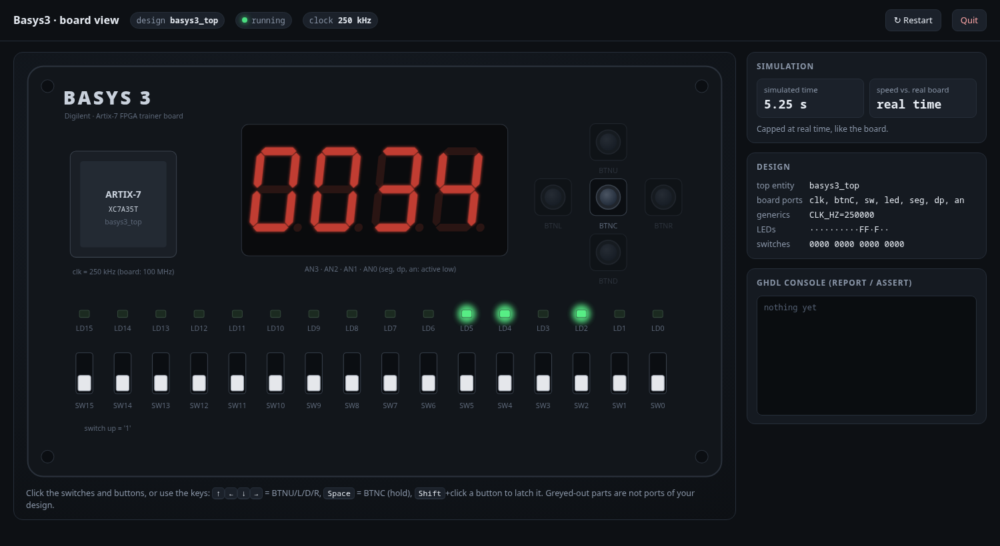

# fpga-board-sim

[](https://github.com/Awareness10/fpga-board-sim/actions/workflows/test.yml)

Work with the Digilent **Zybo** (Zynq-7000) and **Basys3** (Artix-7) boards without
having the hardware on your desk, and use the same files with Vivado/Vitis when you do.
Made for USN's course [CS4110-1 26H Hardware/Software Co-Design of Embedded Systems](https://www.usn.no/studier/studie-og-emneplaner/#/emne/CS4110_1_2026_H%C3%98ST).

| | Zybo | Basys3 |
|---|---|---|
| **Emulated** | ARM programs run in QEMU (`xilinx-zynq-a9`) against a model of the board; the PL designs are tested in GHDL | your VHDL runs in GHDL, clock-accurate |
| **Live board view** | LEDs, buttons, switches, AXI GPIO registers, bus activity, UART console | 16 LEDs, 16 switches, 5 buttons, 4-digit 7-segment display |
| **Real board** | scripted Vivado block design → `.xsa` → Vitis apps → JTAG | Vivado bitstream → program over USB |




**Doing an assignment?** `uv run boardsim new zybo lab1` (or `new basys3 lab1`) gives you
a working starting point in `assignments/lab1/`; [HOW-TO-USE.md](HOW-TO-USE.md) walks
through the whole workflow, from the first testbench to the real board.

Everything is driven by one command-line tool, `boardsim`, written in Python and managed
with [uv](https://docs.astral.sh/uv/). The ARM cross-compiler, CMake and Ninja are
downloaded by [Conan](https://conan.io) on the first build. Windows, macOS and Linux all
run the same commands.

## Install

You need **uv**, **QEMU** (Zybo) and **GHDL** (VHDL). A waveform viewer and Vivado/Vitis are optional.
`boardsim install ghdl` and `boardsim install surfer` download the official build for your
computer, check it, and unpack it into your user folder (`%LOCALAPPDATA%\boardsim` on
Windows); nothing else is changed and no admin rights are needed.
[Surfer](https://surfer-project.org) is a modern waveform viewer; GTKWave no longer has
current Windows or macOS builds. If both are installed, `wave` uses GTKWave, which also
opens the saved signal layouts in `zybo/pl/waves/`.

| | Windows | macOS | Linux |
|---|---|---|---|
| uv | `winget install astral-sh.uv` | `brew install uv` | `curl -LsSf https://astral.sh/uv/install.sh \| sh` (or your package manager) |
| QEMU | `winget install SoftwareFreedomConservancy.QEMU` | `brew install qemu` | `sudo apt install qemu-system-arm` · `sudo pacman -S qemu-system-arm` · `sudo dnf install qemu-system-arm` |
| GHDL | `uv run boardsim install ghdl` | `uv run boardsim install ghdl` (Apple Silicon; needs `xcode-select --install`) | `sudo apt install ghdl` · `paru -S ghdl` (AUR) · or `uv run boardsim install ghdl` |
| waveform viewer (optional) | `uv run boardsim install surfer` | `uv run boardsim install surfer` (or `brew install surfer`) | `sudo apt install gtkwave` · `sudo pacman -S gtkwave` · or `uv run boardsim install surfer` |
| Vivado/Vitis 2023.2 (optional) | default `C:\Xilinx` | not available: use a Windows/Linux machine for this step | default `~/Xilinx`, `/tools/Xilinx` or `/opt/Xilinx` |

Then, in a clone of this repository:

```sh
uv run boardsim doctor     # what's found, and how to install what isn't
uv run boardsim setup      # Conan: default profile + the Arm toolchain recipe
uv run boardsim test       # every GHDL testbench and every ARM program in QEMU
```

Then start your first assignment: [HOW-TO-USE.md](HOW-TO-USE.md).

**Windows:** if `uv sync` / `uv run` fails with a "blocked" or permission error, Windows
is stopping the Python build uv downloads (Smart App Control or a company policy).
Install Python 3.10+ from [python.org](https://www.python.org/downloads/) or
`winget install Python.Python.3.13`; uv prefers an installed Python
(`python-preference = "system"` in `pyproject.toml`).

The first `uv run` creates a virtual environment with Conan in it. The first build
downloads the Arm GNU toolchain (roughly 150 MB). `boardsim` finds QEMU, GHDL and Vivado
in their usual install folders; set `QEMU`, `GHDL`, `GTKWAVE`, `SURFER`, `XILINX_VIVADO` or
`XILINX_VITIS` if yours are somewhere else.

## Zybo

```sh
uv run boardsim zybo run                  # xgpio_btns on the emulated board, in the browser
uv run boardsim zybo run xgpio_blink      # the tutorial's blinking LED
uv run boardsim zybo run xgpio_btns --terminal    # no browser: keys 1-4 toggle BTN0-3
uv run boardsim zybo test                 # PL testbenches + all programs in QEMU
uv run boardsim zybo wave                 # zybo_gpio_tb in GTKWave or Surfer
```

The programs are in `zybo/ps/examples/`: `hello`, `asm_sum` (C calling assembly),
`axi_leds` (a driver for the custom AXI peripheral in `zybo/pl/`), and `xgpio_blink` /
`xgpio_btns`, the Peronnin tutorial's `xgpio_example.c` before and after the
"buttons to LEDs" change (marked `// CHANGED`). `zybo run` rebuilds first, so your edits
are what runs.

In the board view, hold keys `1`–`4` (or click) for BTN0–BTN3; **PS-SRST** restarts the
program. QEMU runs at about the speed of the Zybo's 650 MHz Cortex-A9
(`-icount shift=1`). If your computer can't keep up, the console says so (`QEMU is N s
behind the real chip`); then use `--shift 2` (half speed).

**Exercise (the tutorial's quiz):** make the switches drive the LEDs instead of the
buttons. That takes a change on both sides: in Vivado, what GPIO2 of `axi_gpio_0` is
connected to; in the C code, what the program reads. The emulator models the tutorial's
block design (GPIO2 = buttons); `zybo/ps/model/zybo_board.c` and
`zybo/pl/src/zybo_gpio_top.vhdl` are where that wiring lives.

### On the real Zybo (Windows or Linux, Vivado/Vitis 2023.2)

```sh
uv run boardsim zybo xsa          # Vivado: the tutorial's block design -> bitstream -> .xsa (~5 min)
uv run boardsim zybo vitis        # Vitis: platform + xgpio_blink and xgpio_btns (~5 min)
uv run boardsim zybo jtag xgpio_btns   # load bitstream + program over JTAG and run it
```

This is the original **Zybo** (XC7Z010, 512 MB DDR3), the board used in the course.
The apps are built from the **same** `xgpio_example.c` files the emulator runs. To look around in the IDEs, open
`zybo/build/hw/zybo/zybo.xpr` in Vivado and `zybo/build/hw/vitis_ws` as the
Vitis workspace. For JTAG, set jumper JP5 to JTAG and connect USB to the PROG/UART port;
the program's output is on the board's serial port at 115200 baud. More detail, including
the same steps by hand in the GUI: [zybo/README.md](zybo/README.md).

## Basys3

```sh
uv run boardsim basys3 run              # basys3_top on the emulated board, in the browser
uv run boardsim basys3 test             # every testbench in basys3/tb/
uv run boardsim basys3 wave counter_tb  # a testbench in GTKWave or Surfer
uv run boardsim basys3 bit              # Vivado: bitstream
uv run boardsim basys3 program          # Vivado: bitstream + program a connected Basys3
```

`basys3_top` is a counter on the LEDs and the 7-segment display (`btnC` = reset,
`sw(0)` = pause). For **your own design**, `uv run boardsim new basys3 lab1` and then
`basys3 run lab1` etc. (see [HOW-TO-USE.md](HOW-TO-USE.md)); any other folder with
`src/*.vhdl` (+ `tb/*_tb.vhdl`, `constraints/<top>.xdc`) works too: `basys3 run <folder> --top <entity>`. Name the ports as in Digilent's master XDC
(`clk`, `sw`, `btnC`/`U`/`L`/`R`/`D`, `led`, `seg`, `dp`, `an`). How the board view
simulates your design, and how to make it fast: [basys3/README.md](basys3/README.md).

## Layout

```
assignments/         your work: one folder per assignment (boardsim new ...)
src/boardsim/        the tool: CLI, QEMU and GHDL runners, board view servers, web/ pages,
                     templates/ for boardsim new
conan/               Arm GNU toolchain recipe and Cortex-A9 bare-metal profiles
zybo/ps/             ARM side: BSP, Xilinx driver stand-ins (xil/), board model, examples
zybo/pl/             FPGA side: AXI GPIO + custom AXI-Lite peripheral, testbenches
zybo/vivado, vitis/  scripts for the real board
basys3/              VHDL designs, testbenches, constraints, Vivado script
```

## Outside the course: Zybo Z7

The course uses the original Zybo and the Basys3. The newer **Zybo Z7** is supported only
because it got added along the way: `boardsim zybo xsa --board z7-10` (or `z7-20`), then
`boardsim zybo vitis --board z7-10`. It uses different board files (1 GB DDR3L, other
button pins), so the original Zybo's build won't run on a Z7 and vice versa: check
whether your board says "ZYBO" or "ZYBO Z7". On a Z7 the USB-UART port is J12, and
`zybo/pl/constraints/Zybo-Z7-Master.xdc` has its pins. The Vivado build passes, but it
hasn't been tried on a real Z7, and the board view always shows the original Zybo.

## Status

- **Linux** (Arch-based, Vivado/Vitis 2023.2): all tests, both board views, the Basys3
  bitstream, and the full Zybo flow on a real (original) Zybo: `.xsa`, Vitis builds and
  `zybo jtag`, with `xgpio_blink` and `xgpio_btns` running on the board.
- **Windows and macOS:** `boardsim test` passes in CI (`.github/workflows/test.yml`):
  the Conan toolchain download, the ARM builds, QEMU and GHDL. The board views and the
  Vivado/Vitis commands haven't been tried there by a person yet.
- **Not yet tested:** `basys3 program` on a real board.

Reports and fixes are welcome.

## References

- [Zybo reference manual](https://digilent.com/reference/programmable-logic/zybo/reference-manual) (Digilent)
- [Basys 3 reference manual](https://digilent.com/reference/programmable-logic/basys-3/reference-manual) (Digilent)

## AI disclosure

This project was developed with AI assistance: **Claude Opus 5.5** (Anthropic), used
through **Claude Code**, Anthropic's command-line coding tool, helped write the code,
scripts and documentation. The authors reviewed and tested the result and take full
responsibility for everything in this repository.

## License

MIT, see [LICENSE](LICENSE). Digilent's master XDC files and the Xilinx example code
the tutorial programs are based on carry their own (MIT) licenses.
